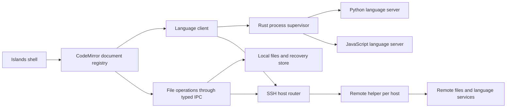

# Islet editor implementation plan

Status: approved specification; functional preview implemented. See [validation record](VALIDATION.md) for measured evidence and outstanding release gates. Created 20 October 2026. Revised to include code-review navigation, symbol rename, mixed local/SSH workspaces, CLI opening, and Markdown reading.

Islet will be a separate desktop editor in this repository. Its defining requirement is the look and feel of PyCharm with Islands Dark and Islands Light: typography, colors, density, tabs, gutters, completion popups, caret behavior, and scrolling. Python and JavaScript intelligence will run alongside the relevant project, locally or on its SSH host. One workspace can contain projects from different machines.

The first release targets macOS, including Apple Silicon, with Linux SSH hosts as the initial remote target. Keep the desktop core portable to Windows and Linux; validate those platforms and additional remote operating systems separately before claiming support. This directory contains planning documents and concept mockups only. The dark and light mockups establish the accepted visual direction.

## Product scope

The first usable version includes:

- Open files or folders; add multiple local and SSH projects to the same workspace, with a compact project tree, saved workspace files, and command-line opening/adding.
- Tabs with preview and pinned states, unsaved indicators, reorder, close/reopen, and session restoration.
- Reliable editing: undo/redo, selections, multiple cursors, indentation, paired brackets, comments, folding, clipboard, and search/replace within a file.
- Find in Files and Replace in Files across the workspace, a project, or a selected folder, available globally and from project-tree context menus. Include filters, streaming results, and replacement preview for local and SSH roots.
- Python and JavaScript/JSX completion, parameter help, hover documentation, inline diagnostics, semantic colors, modifier-click definitions, and references. TypeScript/TSX can use the same language service.
- Persistent line bookmarks, next/previous function navigation, and Back/Forward history that restores the original file, caret, selection, and scroll.
- Intelligent project-wide symbol rename through an editor context menu, with change preview and grouped undo.
- Markdown files open in rendered reading mode, with an obvious Edit Source button and a Preview button to return.
- A custom editor context menu and shared keyboard commands for editing and code review.
- Islands Dark, Islands Light, and system theme selection; font, size, line spacing, ligature, compact-density, and scrolling settings.
- Safe file saving, external-change detection, and recovery of unsaved buffers.

The initial scope excludes terminal panels, run configurations, debugger, Git UI, databases, notebook execution, AI chat, extension marketplace, and refactorings beyond symbol rename. SSH file editing and language intelligence are now required scope. The UI will contain controls for implemented editor actions only. Language-server indexing is allowed where completion and refactoring require it.

The companion [code review and workspace specification](REVIEW_WORKSPACES.md) defines interaction details, proposed shortcuts, CLI examples, SSH behavior, rename safety, Markdown modes, and acceptance scenarios. It is part of this implementation plan.

## Technology decision

| Component | Proposed choice | Reason and condition |
| --- | --- | --- |
| Desktop host | Tauri 2 with a small Rust backend | Uses the system webview and supports native file access and managed child processes. Qualify WKWebView text input and scrolling in the first milestone. |
| UI | TypeScript, Vite, and a small React shell with custom CSS | Predictable component structure; custom styling can follow measured PyCharm geometry. Keep editor state outside React rendering. |
| Text editor | CodeMirror 6 | Modular editing, incremental parsing, and direct styling control suit the restricted feature set. |
| Language client | `@codemirror/lsp-client` behind an Islet adapter | Reuse supported language features; route navigation and rename edits through Islet's shared command/document services. |
| Python | basedpyright | Completion and type analysis plus semantic highlighting. Start with modest diagnostic settings to avoid imposing its stricter defaults. |
| JavaScript | typescript-language-server with a pinned TypeScript version | Project-aware JS/JSX and TS/TSX completion through the same language protocol. |
| Runtime for language services | Bundled local Node and pinned server packages; versioned remote helper/runtime package | Local use works without global Node or first-launch downloads. Remote setup validates host OS/architecture and installs a user-owned helper with consent. Start services only for languages in use. |
| Remote workspace transport | System OpenSSH plus a scoped Islet helper | Reuse SSH config/agent authentication; remote file operations and language services run on their owning host through framed channels. |
| Markdown rendering | markdown-it with selected extensions and sanitized output | Readable Markdown with source/preview switching, local/remote relative assets, and matching light/dark styling. |
| Fonts | Bundled Inter and JetBrains Mono | Same font families as JetBrains, including real italic and weight variants. |
| Persistence | Versioned JSON and recovery files in app data | No database or external service required. |

Tauri's system webview reduces the need to bundle a browser, but the language services and Node runtime still contribute installation size and memory. Measure the complete application, including child processes. [Tauri architecture](https://v2.tauri.app/concept/architecture/) and [Node sidecar guidance](https://v2.tauri.app/learn/sidecar-nodejs/).

CodeMirror's maintained LSP package provides a transport interface; the host is responsible for connecting and supervising the server. Its GitHub repository moved to the author's own forge, so an archived GitHub label does not mean the package was abandoned. Pin a tested release and check its current APIs. [CodeMirror LSP client](https://github.com/codemirror/lsp-client) and [reference manual](https://codemirror.net/docs/ref/).

### Alternatives considered

| Option | Assessment |
| --- | --- |
| Monaco | Strong editor API and existing JavaScript/TypeScript services. A credible fallback if CodeMirror fails the input or language-integration tests. Its built-in UI still needs extensive PyCharm styling, and Python needs a language server. |
| Electron with CodeMirror | Consistent Chromium behavior. Fallback host if WKWebView cannot meet the measured editing requirements; includes a browser runtime. |
| IntelliJ Platform fork | Closest route to the original rendering and behavior, but introduces the platform and project infrastructure beyond the desired lightweight editor scope. |

Choose CodeMirror and Tauri provisionally. Milestone 1 decides whether they meet the actual quality target; it is not a promise of exact rendering or a benchmark result. [Monaco upstream](https://github.com/microsoft/monaco-editor).

## Visual specification

Use the public Islands theme definitions and typography guidance as visual references. Keep display scale, theme, scheme, and font settings fixed during comparisons. Preserve separate tokens for the application UI and code editor: JetBrains explicitly treats a UI theme and editor color scheme separately. [PyCharm colors and fonts](https://www.jetbrains.com/help/pycharm/configuring-colors-and-fonts.html).

The [reference audit](REFERENCE.md) records verified theme colors, font sources, and the remaining measurements. It is the starting point for a token library, not a generic dark palette.

### Typography

- Inter for labels, trees, tabs, and controls, using 13 logical pixels as the starting UI size. Regular text uses weight 400; headings use a real semibold face.
- JetBrains Mono for code, completion code labels, and code snippets. Begin with 13 logical pixels and the reference's line-spacing setting of 1.2; calibrate the resulting CSS line box against the Java renderer rather than equating the multiplier to a guaranteed pixel height.
- Resolve gutter size separately. Preserve correct normal, italic, bold, and bold-italic faces. Disable synthetic bold and italic.
- Keep letter spacing at zero initially. Match ligature behavior to the captured reference and expose a toggle.
- Wait for bundled fonts before measuring the editor to avoid shifting character widths and caret positions.
- Make UI zoom and code-font zoom separate settings. Retest at 100%, 125%, and 150% scale.

JetBrains documents Inter at size 13 for the interface and JetBrains Mono for the editor. Browser and Java text rasterization can differ even with identical font files; acceptance requires matching glyph metrics and a visual review on the same display. [JetBrains typography](https://plugins.jetbrains.com/docs/intellij/typography.html).

### Layout and controls

Use a subdued outer canvas with rounded project-tree and editor regions. Match the selected-tab shape, small gaps, quiet borders, toolbar density, status line, scrollbar thickness, and popup padding to the reference. Measure default and compact modes separately.

The minimal layout is a native window header, a workspace name and editor actions, a project tree, an editor tab strip, a large editing surface, and a small status line. The project tree can collapse completely. Preserve native window dragging, traffic-light placement, fullscreen, menus, and focus behavior.

Completion popups are first-class visual components: icon column, text alignment, matching substring style, type details, selection, scrolling, and documentation panel must all match. Match hover, pressed, focused, disabled, selected, and inactive-window states; screenshots of the idle editor alone are insufficient.

### Syntax and semantic colors

Create a theme mapping for language-neutral roles and explicit Python/JavaScript overrides. Resolve inherited JetBrains scheme attributes before translating them to CodeMirror tags.

The fixture corpus must include Python decorators, classes, methods, fields, parameters, builtins, imports, docstrings, f-strings and escapes; JavaScript imports, functions, properties, constants, async/await, template strings, regexes, JSX tags, and attributes.

Lezer syntax tags provide immediate colors. Language-server semantic tokens refine symbol roles after analysis. Support token modifiers such as declaration, readonly, static, deprecated, and default library where the server supplies them. Do not assume every function call and declaration shares a color.

Verify semantic-token capabilities of the pinned client/server pair. Budget a small CodeMirror decoration extension if the client lacks support: negotiate the legend and encoding, decode token positions, associate results with document versions, discard stale results, and retain syntax highlighting during analysis or failure. Begin with full semantic-token requests; add delta support only if needed.

Basedpyright explicitly supports semantic highlighting. The JavaScript proof must verify the selected TypeScript server's initialization capabilities and returned token categories. Different analyzers can classify symbols differently from PyCharm, so record and fix visible mismatches in the supported fixture corpus. [Basedpyright semantic highlighting](https://docs.basedpyright.com/latest/benefits-over-pyright/pylance-features/).

### Scrolling and input

Keep native trackpad momentum and high-resolution wheel movement. Do not apply a second smoothing animation to trackpad events. Use cancelable animation for keyboard/page navigation and jump commands where it matches the reference.

Keep caret visibility, selection dragging, horizontal scrolling, and tab restoration stable. Honor reduced-motion settings. Test mouse wheel, trackpad, scrollbar dragging, soft wrapping, long lines, and rapid direction changes.

Test native input methods, dead keys, accented characters, emoji, combining marks, and bidirectional text. Completion must not intercept composition or break undo grouping. Smooth scrolling is a measured behavior, not merely `scroll-behavior: smooth`.

## Language intelligence

Run language services on the project's owning machine and communicate using LSP JSON-RPC over standard input/output. For local roots, the Rust backend owns the processes; for SSH roots, a remote helper owns them and transports messages over SSH. Use Tauri IPC between the webview and Rust; no local HTTP server is required. A failed remote connection must not block local editing.

Python environment selection belongs to editor intelligence. Detect `.venv` and `venv`, allow an explicit interpreter, and show the active environment in a small status control. Use the environment for import/type discovery without changing it or installing packages. Respect supported project configuration and extra import paths.

For JavaScript, respect `jsconfig.json`, `tsconfig.json`, package imports, and installed type declarations. Bundle TypeScript as the default; loading workspace TypeScript or plugins requires an explicit setting because those files execute in the service process.

Use one service per host, language, and project/environment boundary, not one per file. For several attached repositories, isolate Python roots with different environments; share a service only when its configuration semantics allow it. Select the owner of a file by host identity and the longest matching canonical root. Preserve host identity through every file URI, definition, reference, diagnostic, and edit. Cap concurrent services and stop idle ones.

Required behavior:

- Completion works with unsaved changes and imports from another file; accepting an auto-import applies its edits as one undoable operation.
- Signature help tracks the active parameter; hover documentation is sanitized before rendering.
- Diagnostics update without moving the caret or stealing focus.
- UTF-16 positions and Unicode edits agree between the editor and server; negotiate another encoding only when fully supported.
- Requests are cancelable; results from stale versions are ignored.
- A service crash leaves file editing usable and offers a bounded restart. Closing a workspace shuts down its owned processes.

Enable the language capabilities required by this scope, including definitions, references, document symbols, prepare-rename, and rename. Route all returned edits through Islet's version-checked transaction service. Implement an explicit workspace/document registry: the default client workspace may not cover retained unsaved documents, remote identities, and later split views.

[Basedpyright installation](https://docs.basedpyright.com/latest/installation/command-line-and-language-server/) and [TypeScript language server](https://github.com/typescript-language-server/typescript-language-server).

## Application structure and contracts

Proposed modules after implementation is authorized:

| Area | Responsibility |
| --- | --- |
| `src/shell/` | Window layout, tabs, tree, status, menus |
| `src/editor/` | CodeMirror setup, commands, document state, selections |
| `src/navigation/` | Bookmarks, function navigation, references, Back/Forward history |
| `src/refactoring/` | Rename preview, version checks, grouped document edits and undo |
| `src/search/` | File/folder/workspace search scopes, filters, streamed results, replacement preview |
| `src/workspaces/` | Multiple roots, host identity, workspace manifests, CLI request routing |
| `src/markdown/` | Sanitized preview, source-mode switching, relative asset resolution |
| `src/themes/` | UI tokens, syntax mappings, font settings, density |
| `src/languages/` | LSP adapters, completion/hover styling, semantic tokens |
| `src/settings/` | Validated preferences and settings UI |
| `src-tauri/src/files/` | File reads, safe saves, directory enumeration, watchers |
| `src-tauri/src/remote/` | SSH connections, authentication prompts, helper bootstrap and channels |
| `remote-helper/` | Scoped remote filesystem operations, watchers and language process ownership |
| `src-tauri/src/languages/` | Bundled runtime, subprocess ownership, LSP framing |
| `src-tauri/src/session/` | Workspace/session state and unsaved recovery |
| `tests/fixtures/` | Python/JS examples, multi-root and file-integrity scenarios |
| `design/reference/` | Versioned measurements and private reference captures |
| `design/validation/` | Screenshots, visual comparisons, performance reports |

Define small typed contracts:

- `openWorkspace(roots)` and `addRoots(workspaceId, roots)` accept local/SSH root descriptors and return validated roots with host and connection states.
- `readDocument(documentId)` returns text, encoding, BOM, newline style, and disk revision; identity includes host and canonical path.
- `saveDocument(documentId, expectedDiskRevision, text, encoding, newline)` routes to the owning host and returns a new revision or a structured conflict.
- `startLanguageService(hostId, projectId, language, environmentId)` returns a session ID and capabilities; send/receive messages are bound to that session.
- `prepareRename(documentId, position, newName)` returns a preview transaction with expected buffer/disk revisions; `applyRename(transactionId)` validates and applies it as a group.
- `navigate(location, reason)`, `goBack()`, and `goForward()` share history across tabs, bookmarks, symbols, and Markdown links.
- Settings carry `schemaVersion`, appearance, editor behavior, language options, and per-root environment choices.
- Workspace state carries stable root and host IDs, connection references, tab order, active tab, selections, scroll positions, bookmarks, navigation history, Markdown modes, and recovery references. Credentials are excluded.

Keep unsaved buffers authoritative in the document registry; React renders shell state, not the complete text after each keystroke. Canonicalize file identity while retaining the user's display path. Save atomically where possible, preserve file permissions/newlines/BOM, and handle symlinks deliberately. Validate the disk revision before overwriting external edits.

Store settings and recovery in the platform's application-data location. Back up files before schema migrations and make migrations repeatable. Do not write editor metadata into source repositories by default.

The renderer has no general shell access. Host operations use scoped root/document IDs and structured arguments. Normalize and validate external file URIs; jump-to-definition may read dependencies outside workspace roots, while saving requires an explicitly opened writable document. Render documentation with a sanitizer and block executable links.

## Milestones and acceptance

| Milestone | Deliverable | Acceptance gate |
| --- | --- | --- |
| 1. Visual and engine proof | One real CodeMirror editing surface in Tauri, both themes, Python/JS fixtures, one working service per language | Same-display PyCharm comparison; correct input/composition; completion, hover, semantic color, scroll and font metrics verified. Decide host/editor before building the shell. |
| 2. File and workspace foundation | Host-aware identities, local roots, tabs, save/recovery, CLI, manifests and scoped Find/Replace in Files | No lost edits, byte/newline preservation, conflict handling, deterministic CLI targeting, and version-checked replacement preview/undo. |
| 3. Code review navigation | Bookmarks, modifier-click, references, function shortcuts, Back/Forward, custom menus and Markdown modes | All commands work from menus and keyboard; original positions restored; preview/source mode preserves content and undo. |
| 4. Intelligence and rename | Environments, semantic colors, completion, diagnostics, rename preview and grouped undo | Cross-file rename respects symbol identity and dirty buffers; Unicode, stale replies, version conflicts and server restart tests pass. |
| 5. Mixed local and SSH workspaces | Helper setup, remote files/services, host routing, reconnection, remote rename, scoped search/replace and Markdown assets | One local plus one remote project works in a single window; remote loss never blocks local work or silently loses remote edits; incomplete search scopes are clearly identified. |
| 6. Islands fidelity | Both themes, custom menus, reference/bookmark popups, rename dialog, Markdown reader, compact mode and scrolling | Visual review passes across all new states; no fallback fonts, clipped popups, baseline drift or caret jumps. |
| 7. Packaged macOS preview | Local runtime/services/fonts and remote helper packages with notices | Offline local launch; clean-host SSH setup; reconnect/recovery and process cleanup verified; complete performance report. |

Milestone 1 should be small enough to discard. Do not build Git, run/debug, or a plugin architecture while evaluating the editor.

## Quality and performance targets

These are provisional budgets for local editing, not measured claims. Record the exact Mac, OS, display refresh rate, build mode, corpus, and service versions in the first benchmark. For SSH, report network latency, remote CPU/memory and server startup separately; keep keystrokes and scrolling local and responsive while requests are in flight.

| Scenario | Initial target |
| --- | --- |
| Cold launch to editable empty window | Under 1.5 seconds on the reference Apple Silicon Mac |
| Open a 1 MB source file | Under 300 ms to editable text |
| Keystroke response | p95 under 16 ms on ordinary source files |
| Scroll | No visible blank regions or persistent dropped-frame bursts at the display's refresh rate |
| Warm language completion | p95 under 250 ms on the fixed project corpus |
| Idle editor memory | Under 200 MB for host and webview combined |
| Editor plus active Python and JS services | Initial target under 600 MB on the fixed corpus; report each process separately |
| Installed footprint | Initial target under 150 MB including bundled runtime, services, and fonts |

Do not reduce correct import analysis to force a memory result. If targets fail, profile before adjusting them; compare against PyCharm and a minimal editor on the same corpus.

Use lazy language loading, a virtualized tree, bounded file watching, and delayed service startup. Exclude generated folders, dependency trees, and virtual environments from project-tree indexing by default. Language servers may still resolve dependencies when analysis requires them.

For files over a provisional 5 MB or with very long lines, offer a large-file mode with expensive analysis disabled and make that status visible. Keep editing usable when intelligence is unavailable.

Verification combines focused unit tests for file/version/position logic, real server integration tests, browser-level editor interaction tests, and native packaged-app tests. Native macOS text input and trackpad behavior must be tested in WKWebView; browser tests alone do not establish correctness.

Run the companion specification's acceptance scenarios for bookmark anchors, navigation history, cross-file rename/undo, mixed hosts with identical paths, SSH interruption during saving, CLI routing, and Markdown links/assets. Include an actual SSH host; mocks alone do not establish remote support.

Visual comparisons use the same fixture, viewport, zoom, scroll, theme, and popup state. Match layout edges and text baselines within one logical pixel where feasible; require exact configured color tokens, and review glyph rasterization separately rather than treating every antialiasing pixel as a failure.

## Distribution and reuse

Ship a macOS preview after the editor gates pass. Include runtime and server versions in diagnostics and reproduce builds from lockfiles. Signing/notarization and broader platform packages belong to the distribution milestone.

Bundle fonts from their upstream distributions with their OFL notices. Keep source provenance and license notices for any reused JetBrains theme/icon material; use Islet's own application name and icon. Use public upstream theme definitions for implementation rather than redistributing files extracted from an IDE installation. [JetBrains Mono](https://github.com/JetBrains/JetBrainsMono), [Inter](https://github.com/rsms/inter), and [IntelliJ Community](https://github.com/JetBrains/intellij-community).

Ship the documented CLI for opening workspace files and adding ordered local/SSH roots. External tools can call that interface; Islet remains usable independently.

## Decisions to validate first

1. WKWebView and CodeMirror must meet the font, caret, IME, and scrolling target on the user's Mac.
2. The pinned LSP client must either support semantic tokens or permit the small adapter described above.
3. basedpyright and TypeScript services must give useful completion without excessive cold startup or background work.
4. Capture the exact PyCharm code font size, weight, line height, ligature setting, scale, and popup geometry in the visual proof; the current audit establishes resources and starting values, not all runtime measurements.
5. Prove cross-file rename and grouped undo with real Python/JS servers before presenting the action as reliable.
6. Prove host-aware URI routing, remote environment resolution and interrupted-save recovery on a mixed local/Linux-SSH workspace before the complete preview release.

The implementation now follows these milestones. See [validation record](VALIDATION.md) for passed checks and remaining platform, physical-input and distribution qualification.

## Offline spreadsheets and file creation (27 October 2026)

Owner authorized CSV/XLS/XLSX editing with Jspreadsheet CE and SheetJS CE, file/folder creation, and configurable folder double-click behavior. Legacy DOC remains deferred; the later authorized DOCX scope is recorded below.

- Lazy-load locally bundled spreadsheet code and CSS. CSV opens in a grid with an editable source toggle. XLS/XLSX open in a workbook data editor with sheet selection, cell editing, undo/redo, and append-row/column controls. Arbitrary row/column shifts, sorting, and formula calculation are excluded from this initial editor; references must not silently move. Preserve formula text without executing it. Clear stale formula caches on edited exports. Advanced Excel layout, charts, pivots, macros and formatting are not guaranteed to round trip through CE.
- Keep UTF-8 CSV values as text, preserving identifiers, detected delimiter, BOM/newline style, multiline quoted fields and ragged rows. Malformed CSV remains available through source editing. Untouched or fully undone grid data retains the exact original buffer.
- Extend existing file snapshots with base64 binary workbook bytes, retaining host identity, revision checks, atomic replacement, filesystem permissions, uncertain-save reconciliation and unsaved recovery. Limit binary workbooks to 10 MB and editable sheets to 5,000 rows, 256 columns and 100,000 cells. Validate all sheets before exposing the editable grid.
- Before replacing a workbook, save and verify its exact original bytes under the owning host's private Islet app-data `workbook-backups/<sha256 of canonical path>/<revision>.<extension>`. Existing corrupted backups block replacement. No backup metadata or editor state is written into the user's project.
- SheetJS CE cannot write BIFF/XLS formulas. Preserve formula edits internally as XLSX and block ordinary XLS save when formulas are present. Offer **Save XLSX Copy…** for workbooks, creating an exclusive new file and leaving the source intact. The source tab retains its unsaved edits after saving a copy.
- Expose New File and New Folder in the Project toolbar, native File menu and project-tree context menu; Cmd/Ctrl+N creates a file. Default to the selected folder or current document's directory. Validate names and root scope, create exclusively, refresh the tree and open new files. New XLS/XLSX files contain a valid blank workbook.
- Settings **Expand folders with** defaults to Double click. Single click selects a folder in that mode; the disclosure arrow and keyboard expansion work immediately. Single click remains selectable in Settings and persists with other preferences.

- Follow-up authorization adds worksheet create, rename, duplicate and delete for XLS/XLSX, with Excel name validation, a last-visible-sheet guard, explicit deletion confirmation and ten-action in-tab structural undo/redo. Rewrite direct formula, defined-name and internal-link sheet tokens on rename/deletion while preserving formula string literals and external workbook references. CSV remains single-sheet. All sheet operations remain in the unsaved document buffer until explicit save.

## Offline DOCX, opening and file operations — 2026-10-27

Owner authorized DOCX with SuperDoc, drag/drop copying into project folders and open/add behavior on the editor, native file associations, remote file downloads and helper-side folder ZIP downloads, plus local Finder-compatible file/folder copy/paste. Fix Open File opening only the parent folder.

Implementation: lazy SuperDoc 1.47.2 AGPL editor, local templates/assets with telemetry off, binary document/recovery/conflict handling and backups; legacy DOC explicitly rejected. SuperDoc 2's proprietary engine was excluded. The live root list is consulted after attaching a selected file's parent. CLI positional files and macOS `RunEvent::Opened` route through the same file opener. Bundle associations use `Editor`/`Alternate` and do not claim defaults.

File operations: scoped manifest/export/import RPCs, bounded chunks, SHA-256 checks, exclusive destination reservation, staged copies, cancellation/progress, temporary remote ZIP cleanup and ten-minute expiring helper sessions. Local file URLs are read/written through system AppKit; test builds can use a private named pasteboard. Existing helpers require protocol version 1 and prompt setup if older. Both Linux architectures and the desktop runtime bundle yazl.

Qualification covers isolated fixtures only. Do not replace the installed app, publish a release, change system defaults, or use a production remote host as part of these tests.

Follow-up: original Excel/Word/CSV SVGs now distinguish formats in tree and tabs. DOCX uses a centered white page on a gray padded workspace, preserving document margins; the toolbar wraps at narrow widths.

Standalone file correction: Open File, positional file arguments, editor file drops and macOS file events now open only the selected file, with an exact local-file grant and no parent root. Selected folders still become projects. Grants retain client ownership and are re-established for recovered standalone tabs; ordinary dependency documents stay read-only.

DOCX zoom: always-visible bottom view controls (minus/plus, 25–400% slider, current percentage/reset, Fit width), Cmd/Ctrl +/−/0 shortcuts, and per-document zoom/mode in recovery. SuperDoc performs the scale/layout changes; zoom is view state and never an edit to Word content.
